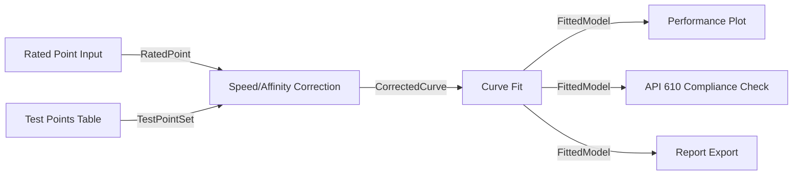
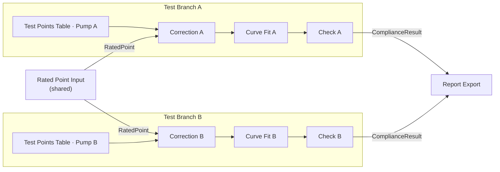

# UI As-Built Register — pumpflow Workbench

> This document is the as-built functional register for the `pumpflow` visual
> workbench. It describes the components, data flow, and behavior of the
> application as implemented. It originated as the UI specification and is
> preserved here as a detailed reference.
> **Paradigm:** an [Orange3](https://orangedatamining.com/)‑style **widget canvas** —
> the user drags nodes onto a canvas and wires them together; data flows along the
> links. Each widget wraps one step of the engineering workflow defined in
> `examples/pump_api610_performance 1.ipynb`.

---

## 1. Goal & Scope (As-Built)

The application is a graphical, node‑based tool that lets a mechanical/rotating‑equipment
engineer reproduce the **API 610 (12th ed.) / ISO 13709** Factory Acceptance Test
(FAT) performance assessment **without writing code**, by assembling a visual
pipeline of widgets.

The application provides the following capabilities:

1. Capture the **rated (design) point** and the **measured test points** of a
   centrifugal pump.
2. Correct measured points to rated speed/density/viscosity via the **affinity
   laws**.
3. Fit performance curves (**3rd‑degree least‑squares polynomial** and **natural
   cubic spline**) for Head, Power and Efficiency vs. Capacity.
4. Visualize **Q×H, Q×P, Q×η** curves with the rated point marked.
5. Evaluate **deviations against API 610 tolerances** and render an APPROVED /
   REJECTED verdict.
6. Export a reusable **data file (JSON)** and a formatted **`.docx` report**.

The engineering math **reuses the existing `pump` library** (see
§4 *Library Binding*). The UI is a thin orchestration + visualization layer; it
does not re‑implement physics that the library already provides.

### Non‑goals
- No new physics or correlations beyond what the library/notebook already contain.
- No multi‑user, cloud, or database features. Single‑user desktop tool.
- No authentication.

---

## 2. Reference Workflow (from the notebook)

The notebook `pump_api610_performance 1.ipynb` is the **canonical workflow** and the
UI mirrors its seven stages:

| # | Notebook stage | UI widget (see §5) |
|---|----------------|--------------------|
| 1 | Configure environment | *(implicit — app startup)* |
| 2 | Input: rated point + test points | **Rated Point Input**, **Test Points Table** |
| 3 | Correct points to rated speed (affinity laws) | **Speed / Affinity Correction** |
| 4 | Curve fit: polynomial deg‑3 + natural cubic spline | **Curve Fit** |
| 5 | Visualizations Q×H, Q×P, Q×η | **Performance Plot** |
| 6 | API 610 deviation & tolerance evaluation | **API 610 Compliance Check** |
| 7 | Export report (data file) | **Report Export** |

A pre‑wired **default pipeline** is provided so a new user sees the full chain
already connected on first launch:



### Multiple pumps sharing one rated point & fluid (A/B units)

A common API 610 case is testing **two (or more) physical pumps against the same
rated point and the same fluid** — e.g. parallel‑operation A/B units. The graph
must support this **without duplicating the rated point**: a single
**Rated Point Input** fans its `RatedPoint` signal out to **one test branch per
pump**, and all branches **merge into a single Report Export** node (whose
multi‑input port keys each dataset by the pump TAG, exactly as
`ReportGenerator` already expects — see §5.7):



- The shared **rated point and fluid are entered once** and reused by every
  branch; editing them re‑evaluates all pumps reactively.
- Each pump has its **own measured test points** and therefore its own corrected
  curve, fit, plot and verdict.
- The combined report contains one **Test Data — `<TAG>`** section per pump plus a
  consolidated header, and the overall acceptance status reflects **all** pumps.
- Adding a third pump is just dragging another Test Points Table branch and wiring
  it to the same Rated Point Input and the same Report Export.

---

## 3. Data Model & Inter‑widget "Signals"

Following Orange's model, widgets communicate by emitting and consuming typed
**signals** over the links. Define these payload types (plain Python objects /
dataclasses serializable to JSON):

| Signal type | Produced by | Consumed by | Payload |
|-------------|-------------|-------------|---------|
| `RatedPoint` | Rated Point Input | Correction, Fit, Check, Report | TAG, Q, H, N, P, η, head‑shutoff, rated density (rel + abs), nominal viscosity, pressure unit, standard label, parallel‑operation flag |
| `TestPointSet` | Test Points Table | Correction | **pump TAG** (the physical unit, e.g. `B‑2351105A`) + list of raw measured rows (Q, P_suc, P_dis, T_water, N, P, optional η/Head) + pressure unit |
| `CorrectedCurve` | Speed/Affinity Correction | Curve Fit, Plot, Report | pump TAG + a `pump.PerformanceCurve` (points corrected to rated speed) + the `Fluid` used |
| `FittedModel` | Curve Fit | Plot, Check, Report | pump TAG + polynomial coeffs (H, P, η) + spline objects + the `PerformanceCurve` + chosen degree |
| `ComplianceResult` | API 610 Compliance Check | Report | pump TAG + per‑parameter actual/predicted/deviation/tolerance/verdict + per‑pump overall verdict |
| `ReportBundle` | (assembled in Report Export) | — | shared rated point/fluid + **one entry per pump TAG**, ready for `.docx`/JSON serialization |

**Identity convention:** `RatedPoint.TAG` is the **service / datasheet** tag and is
*shared*; each `TestPointSet.TAG` is the **physical unit** tag and is *unique per
branch*. Every downstream signal carries its branch's pump TAG so the Report Export
can key datasets without ambiguity. The pump TAG also labels each plot/verdict so
the user can tell branches apart on the canvas.

**Rules**
- Signals are **immutable**: a widget recomputes and re‑emits a fresh payload when
  its inputs or settings change (matching the library's "always return a new
  instance" convention in `PerformanceCurve.to_speed` / `to_fluid`).
- Re‑emission propagates **downstream automatically** (reactive graph). Changing a
  field in Rated Point Input must live‑update the plot and the verdict — and when
  the rated point fans out to several pumps, **every** branch re‑evaluates.
- **Fan‑out:** one output port may connect to many downstream nodes (the shared
  `RatedPoint` drives N test branches). **Merge:** the Report Export input port is
  **multi‑connection** — it accepts a `ComplianceResult`/`FittedModel` from each
  branch and collects them into a list keyed by pump TAG. Connecting/disconnecting
  a branch adds/removes that pump from the report with no other rewiring.
- Each widget shows a **status line** (Orange‑style) summarizing its output
  (e.g. "Pump A · 5 points · corrected to 1750 rpm").  Its state dot carries a
  glyph (✓ ok, ! invalid, ✗ error/rejected, hollow ring idle), so state never
  relies on colour alone.  Nodes that judge something show a **verdict pill**
  instead (§11).

---

## 4. Library Binding (mandatory)

The UI must call into `pump` rather than duplicate logic. Key bindings:

| UI concept | Library entry point |
|------------|---------------------|
| Fluid (test water / rated fluid) | `pump.Fluid(name, density=Q_(...), viscosity=Q_(...))` |
| Rated / design point | `pump.DesignPoint(fluid, capacity=Q_, differential_head=Q_, head_shutoff=Q_, breaking_power=Q_, ...)` |
| Measured / corrected point | `pump.TestPoint(fluid, capacity=Q_, speed_of_rotation=Q_, _head=Q_, breaking_power=Q_, ...)` |
| Head from suction/discharge pressures | `TestPoint.pressure_head` / `compute_head` (TDH = pressure + velocity + elevation head) |
| Hydraulic power & efficiency | `TestPoint.hydraulic_power`, `TestPoint.efficiency` |
| Collection of points | `pump.PerformanceCurve(fluid, points, polynomial_degree=3)` |
| Affinity‑law speed correction | `PerformanceCurve.to_speed(Q_(N_rated, "rpm"))` |
| Density/fluid correction | `PerformanceCurve.to_fluid(rated_fluid)` |
| Polynomial fit + predictions | `PerformanceCurve.fitter.*_coeffs`, `predict_head/efficiency/breaking_power`, `predicted_data` |
| Built‑in matplotlib curve | `PerformanceCurve.plot_performance_curve(capacity=, return_io=True, *_ylim=)` |
| Tolerance limits & verdict tables | `pump.PerformanceChecker(design_point, curve)` → `acceptable_limits`, `check_summary`, `test_summary_with_limits`, `report_summary` |
| `.docx` report (EN/PT) | `pump.ReportGenerator(language=, template_path=).generate_report(report_data, output_file=)` |
| Units everywhere | `pump.Q_` + `quantity_factory`; honor `STANDARD_UNITS` (capacity m³/h, head m, power kW, efficiency %, speed rpm, pressure kgf/cm² or bar) |

> **Note on tolerances:** the library's `PerformanceChecker` encodes head ±3 %,
> shutoff tolerance by head band (≤75 m → 10 %, ≤300 m → 8 %, else 5 %), power
> +4 %. The notebook uses power band (≤75→3 %, ≤300→8 %, else 5 %). The
> **library's `PerformanceChecker` is the source of truth**; expose its
> tolerances as editable defaults in the Compliance Check widget (§5.6) and warn
> if the user overrides them.

> **Spline:** the library only ships polynomial fitting. The natural cubic spline
> from the notebook (cell 8, `NaturalCubicSpline`) is **not** in `pump` — port it
> into the UI layer (or, preferred, contribute it to `pump`) as a secondary fit
> the user can toggle. Polynomial degree‑3 is the API‑610 default and must be the
> primary curve.

---

## 5. Widget Catalog

Each widget below specifies: **Inputs → Outputs**, the **control panel** (left
settings pane), the **main area** (canvas/preview), and **validation**. All
widgets follow the Orange convention: a compact icon node on the canvas, and a
double‑click‑to‑open property dialog.

**Window size.**  Every property dialog is an independent window that can be
minimised and maximised from its title bar.  Chart and table windows
(Performance Plot, Test Points, MRT Log, MRT Check, NPSH, Curve Fit, Explore Chart,
Selection, System Curve, Operating Point, Compliance) also carry a
**Maximize / Restore** button in the header; double‑clicking the header or
pressing **F11** does the same.  Each node type reopens at its last size and
maximised state, kept in the app settings (`QSettings`, key
`dialogs/<kind>/geometry`), never in the `.pumpflow` file.

### 5.1 Rated Point Input
- **Inputs:** none (source node). Optional: a loaded JSON file.
- **Outputs:** `RatedPoint`.
- **Controls:**
  - TAG (text), Standard label (text, default `"API610 (12a ed.) / ISO 13709 + N-553"`).
  - Q [m³/h], H [m], N [rpm], P [kW], η [%] (optional), Head shutoff [m] (optional).
  - Rated density — entered as relative density **and** kg/m³ (auto‑convert, keep
    in sync), nominal viscosity [cSt].
  - Pressure unit selector: `kgf/cm²` | `bar` (drives `pressure_to_head`).
  - Parallel‑operation checkbox.
- **Validation:** Q ≥ 0, H > 0, N > 0, P > 0; show inline errors; node turns amber
  on invalid and emits nothing.
- **Binding:** constructs a `Fluid` (rated) + `DesignPoint`.

### 5.2 Test Points Table
- **Inputs:** none (source). Optional JSON file.
- **Outputs:** `TestPointSet`.
- **Controls:** a **Pump TAG** field identifying the *physical unit* under test
  (e.g. `B‑2351105A`). This is what distinguishes one branch from another when
  several pumps share the rated point; it must be unique among connected branches
  (warn on collision) and defaults to the rated TAG with an `A`, `B`, … suffix.
- **Main area:** an **editable spreadsheet‑like grid**, one row per measured point:
  `Q [m³/h] · P_suction · P_discharge · T_water [°C] · N [rpm] · P [kW] · (Head, η — computed/optional)`.
  - Add/remove/reorder rows; paste from clipboard (Excel‑friendly);
  - Accept comma **or** dot decimal separators (the example JSON uses
    `"858,29"` style) and trim/parse to float.
  - A read‑only computed column shows **Head = (P_dis − P_suc)/(ρ·g)** using the
    water density at `T_water` (port the notebook's `water_density_kgm3`
    polynomial) and the selected pressure unit — live as the user types.
- **Validation:** at least 3 points required for a degree‑3 fit (block fit with a
  clear message otherwise); warn if a shutoff point (Q≈0) is missing.

### 5.3 Speed / Affinity Correction
- **Inputs:** `RatedPoint`, `TestPointSet`.
- **Outputs:** `CorrectedCurve`.
- **Controls:** target speed (default = rated N, editable), toggles for which
  corrections to apply: speed (affinity), density (ρ_rated/ρ_test), viscosity
  (nominal‑viscosity factors). Show the affinity formulas as read‑only reference:
  Q∝N, H∝N², P∝N³.
- **Main area:** before/after table (measured vs corrected Q,H,P,η) — mirror the
  notebook's printed correction table.
- **Binding:** build `TestPoint`s from the raw rows, wrap in
  `PerformanceCurve(test_fluid, points, polynomial_degree=3)`, then
  `.to_speed(Q_(N_target,"rpm"))` and `.to_fluid(rated_fluid)`.

### 5.4 Curve Fit
- **Inputs:** `CorrectedCurve`.
- **Outputs:** `FittedModel`.
- **Controls:** polynomial degree (default **3**, range 2–5), spline on/off,
  resolution of the smooth curve.
- **Main area:** show fitted coefficients for H, P, η and R²/residual summary;
  small inline preview of the three fits.
- **Binding:** `PerformanceCurve.fitter.head_coeffs / power_coeffs /
  efficiency_coeffs`; spline ported from notebook (`NaturalCubicSpline`).

### 5.5 Performance Plot
- **Inputs:** `FittedModel` (and `RatedPoint` for the marker; optional
  `NPSHResult` from an NPSH node).
- **Outputs:** optional `image/png` (BytesIO) for the report.
- **Main area:** three stacked, shared‑x charts **Q×H (tallest), Q×P, Q×η**, each
  with: corrected data points (markers), polynomial curve, spline curve (dashed),
  and a crosshair at the rated capacity with value labels.  With `NPSHResult`
  wired, a fourth chart **Q×NPSHr**: NPSH3 test points, their fit over the tested
  range, NPSHa as a dash‑dot line and the quoted NPSHr (◇) at rated flow.
- **Interaction:** matplotlib toolbar (home, back/forward, pan, zoom, save) and a
  hover cursor across every chart with a readout of Q, H, P, η and NPSHr from the
  fits (tested range only).
- **Controls:** per‑axis y‑limits (head, power, efficiency, NPSHr) with "auto":
  while on auto the fields show the limits in use (calculated, or as zoomed),
  so unticking auto starts from them; `npsh_ylim` is stored only when set.
  Toggle polynomial/spline/points, "Export PNG".
- **Binding:** prefer `PerformanceCurve.plot_performance_curve(capacity=rated_Q,
  return_io=True, head_ylim=, power_ylim=, efficiency_ylim=)` for the report image;
  the on‑canvas interactive version may overlay the spline that the library plot
  lacks.  When the branch carries an NPSH result, the report image adds the same NPSHr
  chart (`plot_performance_curve(npsh_curve=, npsha=, npshr_quoted=)`).  The
  B‑34004A reference project wires `npsh_a → plot_a` (and `npsh_b → plot_b`).

### 5.6 API 610 Compliance Check
- **Inputs:** `FittedModel`, `RatedPoint`.
- **Outputs:** `ComplianceResult`.
- **Main area:** a results table, one row per evaluated parameter
  (**Head**, **Power**, **Efficiency**, **Shutoff Head**), columns:
  *Actual (rated) · Predicted (from curve) · Min · Max · Deviation · Tolerance ·
  Verdict (✅/❌)*; plus a bold **overall verdict** banner.
  - Deviation per notebook: `δ = 1 − nominal/predicted`.
  - Verdict logic per notebook `status()`: head |δ|≤tol; power δ≤tol;
    efficiency δ≥−tol.
- **Controls:** a collapsed **"Override acceptance criteria…"** section (opened
  automatically when an override exists) with the tolerance fields pre‑filled
  from the acceptance criteria of the rated point's edition and client overlay,
  a **Reason** field and a reset‑to‑criteria button; a warning chip when the
  user overrides the defaults.  An override is shown as an `OVERRIDDEN` chip on
  the canvas node and in Report Export, and the report states every overridden
  tolerance next to its criteria default, with the reason (or "Reason: not
  given").  The report's summary limits use the same tolerances as the verdict
  (`PerformanceChecker(tolerances=…)`).
- **Binding:** `PerformanceChecker(design_point, curve)` →
  `acceptable_limits`, `test_summary_with_limits`, `check_summary`,
  `report_summary`.

### 5.7 Report Export
- **Inputs:** the shared `RatedPoint`, plus a **multi‑connection** input that
  accepts one branch bundle (`CorrectedCurve` + `FittedModel` + `ComplianceResult`
  + plot PNG) **per pump**. One connected branch → single‑pump report; N branches →
  one consolidated report covering all units.
- **Outputs:** files on disk.
- **Controls:**
  - **Equipment description** key/value editor — **per pump TAG** (a sub‑table for
    each connected branch: manufacturer, model, serial, etc.), since two physical
    units differ even when the service is the same.
  - Language: **EN | PT** (drives `ReportGenerator(language=...)` and the
    `template_en.docx`/`template_pt.docx`).
  - Output folder + filename. Default `Report_<service-TAG>_<dd-mm-YYYY>.docx` for a
    multi‑pump report, or `Report_<pump-TAG>_…` when a single branch is connected.
  - Buttons: **Export `.docx`**, **Export `.json`** (reusable data file matching
    the schema in §6), **Export PNG**.
- **Binding:** assemble the `report_data` dict shaped exactly as
  `ReportGenerator.generate_report` expects — the design point is shared, and
  `test_data` gets **one keyed entry per pump TAG** (the loop
  `for tag, test_data in report_data["test_data"].items()` in `generate_report`
  already renders a *Test Data — `<TAG>`* section for each):
  ```python
  {
    "equipment_description": {"TAG": "<service-TAG>", ...},
    "design_point": <DesignPoint>,            # shared rated point + fluid
    "test_data": {
        "<pump-A-TAG>": {
            "test_summary": <report_summary dict>,       # from Check A
            "test_data":    <PerformanceCurve.test_data>, # from Correction/Fit A
            "Performance Curve": <BytesIO PNG>,           # from Plot A
        },
        "<pump-B-TAG>": {
            "test_summary": <report_summary dict>,        # from Check B
            "test_data":    <PerformanceCurve.test_data>, # from Correction/Fit B
            "Performance Curve": <BytesIO PNG>,           # from Plot B
        },
    }
  }
  ```

---

## 6. Persistence

### 6.1 Project file (the canvas)
Save/Load the **whole workflow** (node positions, links, every widget's settings
and entered data) to a single `.pumpflow` JSON file. Re‑opening restores the
pipeline and recomputes downstream signals.

### 6.2 Data‑exchange JSON
The **Test Points Table** and **Rated Point Input** widgets must round‑trip a
simple JSON data file with the following shape (note the locale‑style
comma‑decimal string values, which the importer must parse):

```json
{
  "unit": "bar",
  "rated": { "tag": "...", "q_m3h": "833", "head_m": "73", "n_rpm": "1750",
             "power_kw": "252", "dens_rel": "0,736", "visc_nom_cst": "0,567",
             "head_shutoff": "117" },
  "points": [
    { "q": "858,29", "p_suc": "1,81", "p_dis": "9,47", "temp_c": "34",
      "head": "78.552", "power": "298,69", "n_rpm": "1799" }
  ]
}
```
- Importer must accept the comma‑decimal strings shown above.
- Exporter should emit the same shape so existing `.json` files and the new tool
  stay interoperable. The richer §7 report bundle (corrected points, predictions,
  deviations, verdict) extends — but does not break — this format.

---

## 7. Cross‑cutting Requirements

- **Reactive recompute:** editing any upstream value re‑runs the downstream graph
  and refreshes plots/verdict within ~200 ms for the typical ≤10‑point dataset.
- **Units:** all displayed quantities carry units and follow `STANDARD_UNITS`
  (capacity m³/h, head m, power kW, η %, speed rpm). Pressure input toggles
  kgf/cm² ↔ bar. Never show a bare number where a unit is expected.
- **Localization:** UI labels and the report both support **EN and PT‑BR** (the
  library already ships `locales/en` and `locales/pt` + `template_en/pt.docx`).
- **Validation & safety:** widgets emit nothing while inputs are invalid; nodes
  surface an amber/red state with a tooltip explaining what's missing
  (mirrors the notebook's `[AVISO] Execute o formulário…` guards).
- **Error surfaces:** library exceptions (e.g. `ValueError: All TestPoints must
  have the same fluid`, missing `breaking_power`) are caught and shown as
  human‑readable widget errors, not stack traces.
- **Determinism:** given the same inputs, the verdict and exported files are
  byte‑reproducible (fixed number formatting, `:0.02f~P` style as the library uses).

---

## 8. Suggested Tech Stack

- **Library/runtime:** Python 3.12 (matches `environment.yml`), the existing
  `pump` package as a dependency, `pint`, `numpy`, `matplotlib`, `python-docx`,
  `tabulate`.
- **Canvas framework:** a **standalone, lightweight node‑graph desktop app** built
  on **PySide6 (Qt)** plus a node‑editor library such as
  [NodeGraphQt](https://github.com/jchanvfx/NodeGraphQt). This keeps the Orange3
  *paradigm* (drag‑and‑wire widgets, reactive signal flow) without pulling in the
  full Orange3 runtime — the goal is a small, self‑contained binary, not an Orange
  add‑on. Do **not** depend on `Orange3`/`orangewidget`.
- **Packaging:** ship as a single self‑contained executable
  (PyInstaller/Briefcase) so the engineer can run it without a Python install.
  Keep the dependency tree minimal (Qt + matplotlib + the `pump` library and its
  existing deps; no heavy data‑science stack).
- Charts via matplotlib embedded in the canvas (Qt `FigureCanvas`), reusing
  `plot_performance_curve` for the report image.

---

## 9. Acceptance Criteria

A reviewer must be able to, **end‑to‑end and only via the GUI**:

1. Enter (or import from a JSON data file, §6.2) a rated point plus its measured
   test points into the Rated + Test widgets.
2. See the corrected points after affinity correction to the rated speed.
3. See degree‑3 polynomial **and** spline curves on Q×H, Q×P, Q×η with the rated
   point marked.
4. Read an API 610 verdict table whose numbers match
   `PerformanceChecker(...).report_summary` / `test_summary_with_limits` for the
   same inputs.
5. Export a `.docx` report identical in structure to the repo's existing
   `Report_*.docx`, and a `.json` that re‑imports cleanly.
6. Save the canvas, reopen it, and recover the identical pipeline and results.
7. **Two‑pump case:** add a second Test Points Table (Pump B) with its own measured
   data, wire it to the **same** Rated Point Input and the **same** Report Export,
   and obtain a single `.docx` containing a separate *Test Data — `<TAG>`* section,
   plot and verdict for **each** pump — all sharing the one rated point and fluid,
   with the rated point entered only once.

## 10. Nodes and persistence added by 001_masterpiece

| Kind | Inputs | Outputs | Key settings |
|------|--------|---------|--------------|
| `mechanical_run` (**MRT Log**) | — | MechanicalRunSet | pump TAG, channels (name, dimension, unit, role), 15-min readings, paste |
| `mechanical_run_check` (**MRT Check**) | MechanicalRunSet, RatedPoint (opt.), FittedModel (opt.) | MechanicalRunResult | limit overrides; shows the verdict, per-channel table and trend plot |
| `npsh` | RatedPoint (opt.) | NPSHResult | mode (NPSHr points / NPSHa calculator), per-column units, margin-rule overrides |
| `trim` | FittedModel or CorrectedCurve, RatedPoint | CorrectedCurve | mode (target diameter / solve for rated duty), max trim % |
| `system_curve` | Fluid (opt.) | SystemCurveSpec | mode (static + k / two points / pipe Darcy–Weisbach), units per field |
| `operating_point` | FittedModel, SystemCurveSpec | OperatingPointResult | method (poly / spline) |
| `selection` | — | RatedPoint (chosen candidate) | duty Q/H with units, catalogue folder |

**MRT Log → MRT Check.**  The mechanical running test is two nodes: the log is
data entry only; the check judges it against the criteria of the wired rated
point (edition, client overlay, pump type).  A fitted curve wired into the
check gives the BEP power for the 11th/12th-edition high-speed vibration rule.
Projects saved with the earlier single `mechanical_run` node (log + overrides +
verdict) are split on load by `persistence.split_mechanical_runs`.  The node
keeps its log, and a `<id>_check` node placed below it takes the overrides,
the rated-point wire and the Report Export wire.  The verdicts are unchanged.

Comparison of pumps (UC-08) is not a node: the Explorer readout shows Δ % vs the
first model and Report Export adds a "Comparison" section when ≥ 2 pumps are fitted.

**Rated Point** gains: unit choice for every field, standard/edition and client
overlay pickers (`standard_key`, `client`), impeller nominal/min/max diameters.
**Test Points** gains: one unit per column with g/a pressure reference, header-row
paste (`Q [gpm]`), optional test-bench geometry (pipe IDs, gauge elevations).

**Persistence — schema v2** (ADR-0011): every quantity is stored as
`{"value", "unit"}` (compact Pint spelling); `meta.schema_version = 2`;
`persistence.migrate` upgrades v1 files losslessly on open (missing `*_unit` keys
take the canonical unit, never the active preset); the Qt-free
`pumpflow/settings_codec.py` translates runtime settings ↔ disk; unset optional
quantities are omitted on disk.

---

## 11. Verdicts on the canvas (UI/UX review, 2026-11-17)

**One vocabulary.**  Every view of a performance verdict (canvas status line,
Compliance window, Report Export, report) uses `ComplianceResult.verdict_text`:
`APPROVED ✓`, `NOT FULLY ASSESSED ⚠` or `REJECTED ✗`, qualified with
`provisional` (criteria not verified against the standard text) and
`tolerances overridden`.  Report Export's consolidated verdict over several
pumps is REJECTED if any pump is rejected, else NOT FULLY ASSESSED if any pump
is, else APPROVED; a NOT FULLY ASSESSED pump is never shown as REJECTED.

**Verdict pill.**  Compliance, Report Export, MRT Check and NPSH set
`BaseNode.badge` (`(text, tone)`, tone `ok` / `fail` / `warn`) and
`badge_notes` (`OVERRIDDEN`, `PROVISIONAL`).  The canvas paints the pill and the
note chips at the start of the status line; the status text beside the pill
drops the segment that repeats the verdict.  Below a zoom of
`LOW_DETAIL_LOD` (0.75) the node body shows only the verdict pill (or a large
state glyph) and the title, so a whole FAT reads at a glance.

**First open.**  A node window opened for the first time (no remembered size)
is sized to its content, up to 90 % of the screen width and 85 % of its
height; table columns get at least their header width (`ui.fit_table_headers`).

### 11.1 Proposed: shared inputs without wires (not implemented)

The rated point and the test fluid feed almost every node.  In the B‑34004A
reference project one Rated Point node sends about 20 links across the canvas,
which hides the real data flow (test points → correction → fit → check).

Proposal, to be decided before implementation:

1. **Project context.**  A canvas may hold one Rated Point node and one Fluid
   node marked *shared*.  Nodes with an unwired `RatedPoint` / `FluidSpec`
   input take the shared one; the input port then shows a small *context*
   badge (`◆ B‑34004`) instead of a link.  An explicit link still wins (A/B
   cases with two rated points stay possible).
2. **Edge emphasis.**  Links from shared sources are drawn faint and bundled,
   and become solid only while the source or a target is selected.
3. **Persistence.**  `shared: true` on the node's settings, omitted when unset
   (schema v2 stays byte‑identical for existing files); migration does not
   remove existing links.
4. **Acceptance.**  The B‑34004A reference project shows at most the per‑branch
   links when its Rated Point is shared; exported verdicts are unchanged.

Open questions: whether Report Export should also take the shared rated
point; how a second *shared* rated point is refused; whether option 2 alone is
enough.

## 12. Toolbox, welcome and form states (UI/UX review, round 2, 2026-11-18)

- **Toolbox** (dock titled "Nodes", scrollable) and the **Add node** menu list the
  node kinds in five sections, in the order a FAT is built
  (`nodes.registry.NODE_GROUPS`): *Inputs* (Rated Point, Fluid, Test Points,
  MRT Log, Point), *Corrections* (Speed, Trim), *Curves & analysis* (Curve Fit,
  Performance Plot, Performance Explorer, System Curve, Operating Point, Pump
  Selection), *Checks* (Compliance, MRT Check, NPSH) and *Output* (Report
  Export, Note).  A kind not listed falls into a trailing "Other" section.
- **Node glyphs** are distinct, monochrome text symbols (no colour emoji) and
  never one of the state glyphs ✓ ! ✗ of §11: Fluid ≈, System Curve ∪,
  Compliance ⚖, MRT Check ◈, Pump Selection ⊕.
- **Disabled fields read as disabled**: inputs, combos, checkboxes and their
  field labels take the `disabled-*` tokens.  The Test Points bench-geometry rows
  (label, value, unit) are disabled while "Apply bench geometry" is off.
- **Checked checkboxes** carry a tick (`check-mark` token, an SVG drawn by
  `pumpflow.style.check_mark_path`), not only an accent fill.
- **Rated Point**: the free-text field is "Label on report cover", placed under
  Standard / edition and Client overlay.  It follows those combos, can be edited
  to add documents, and never changes the acceptance criteria.
- **Welcome**: "Demo pipeline" (formerly "Skip") builds the built-in demo, as
  closing the window does; "&" in example titles is escaped; each recent
  project shows its file name, folder and modified date.

## 13. Web version (002_web)

The browser version runs the same Python (`pump` and the node logic) in Pyodide.  This
section lists only what differs from the desktop workbench.  Build, serve and install are
in [`docs/web.md`](web.md); the design is in ADR [0013](adr/0013-web-version-pyodide.md).

- **Scope.** Twelve witness kinds have a form: Rated Point, Fluid, Test Points, Speed
  correction, Curve fit, Performance plot, Compliance, NPSH, MRT Log, MRT Check, Report
  Export and Note.  The other kinds (Point, Trim, Performance Explorer, System Curve,
  Operating Point, Pump Selection) open and evaluate, and show "Edit this node in the
  desktop app".
- **Layout.** Double-clicking a node opens its form in a **side panel**, not a window.
  Under 900 px wide the panel takes the full screen.  Under 700 px the toolbox collapses.
- **Same vocabulary.** Verdict pills, chips (OVERRIDDEN, PROVISIONAL), state glyphs and the
  zoomed-out overview are as in §11; toolbox groups and node glyphs are as in §12.  Labels,
  units, parsing and display strings come from Python, so they match the desktop.
- **Reports.** Word (`.docx`), HTML and the test data summary (`.xlsx`) are exported in the
  browser.  "Print to PDF" opens the HTML report and the browser's print dialog.  The
  LaTeX and PDF report is **desktop only**.
- **Projects.** The same `.pumpflow` files: open, save, drag and drop.  The desktop opens a
  file saved by the browser unchanged.
- **Offline rule.** After the first load the app makes no network request.  The Python
  engine and the wheels are vendored in the bundle; there is no CDN, no
  analytics and no remote content.  The top bar shows "Ready offline" once the browser has
  stored the app.
- **One-engine rule.** TypeScript never computes a quantity or a verdict.  It sends a
  `.pumpflow` document to `pumpflow.webapi` and displays what comes back; `webapi` is the
  only boundary.
- **Parity gate.** `npm --prefix web run parity` evaluates the fixture projects in Pyodide
  and in desktop Python and fails on any difference in states, statuses, badges or
  compliance limits.  CI runs it on every push (job `web`).
- **Design tokens** apply as in §12: colours, radii and font sizes come from
  `pump/design/tokens.json`; the web theme is light only.
